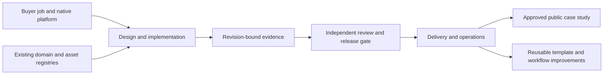

# Starlight Web & App Studio Kit

Version 0.2.0 · local candidate · MIT · Node.js 22.16 or later

A reusable delivery workspace for independent builders and small agencies turning an idea into a maintained website, application or platform. It connects the buyer brief, design decisions, domain ownership, search plan, implementation evidence and handoff.

The implemented foundation includes a dependency-free workspace initializer, evidence inspector, dependency graph and a native static Studio website with a working local brief builder. Four requirement presets and nine operating guides connect the layers. **Application backends, native builder adapters, live domain automation, hosted software and commercial release remain open work.**

The [Studio code edition](site/README.md) turns the kit into a working example: visitors select a project, enter its purpose, inspect the delivery outline and download a record accepted by the CLI. Generate a preview with `node packs/web-platform-studio-pack/site/build.mjs <new-output-directory>`. Read [graph and upstream selection](references/graph-and-upstream.md) for the source-backed mechanics and actual implementation boundaries. Official/community source observations and revision pins are in `sources.json`.

## Try the implemented slice

For a standalone pack download, enter the `web-platform-studio-pack` directory and run `node studio.mjs init <new-directory>`, `node studio.mjs plan <directory>`, or `node site/build.mjs <new-preview-directory>`. The pack carries its own license and needs no surrounding repository. Run its tests with `node --test --test-concurrency=1 test/studio.test.mjs test/graph.test.mjs test/site.test.mjs`. The repository registry commands below apply only in the full source checkout.

From the `agentic-business-os` repository, choose a destination whose parent exists and whose final directory does not exist:

```sh
node packs/web-platform-studio-pack/studio.mjs init ./studio-example --edition marketing
node packs/web-platform-studio-pack/studio.mjs check ./studio-example
node packs/web-platform-studio-pack/studio.mjs report ./studio-example
node packs/web-platform-studio-pack/studio.mjs plan ./studio-example
```

The final command intentionally returns exit code **2** for a fresh workspace: its evidence is missing. It prints the next concrete action and every applicable requirement. Nothing is sent to a service. No account, DNS, application code or commerce configuration is changed. Use the CLI from the installed pack; a generated workspace contains your project documents and evidence, rather than a second copy of the executable.

| Command | Result | Exit codes |
|---|---|---|
| `init <new-dir> [--edition ...]` | New workspace; refuses an existing destination and linked paths | 0 created, 1 error |
| `check <dir>` | Project record structure check | 0 structurally valid, 1 invalid/error |
| `report <dir>` | Local evidence freshness, revision, file hash and reviewer-consistency checks | 0 all required receipts recorded, 1 invalid/error, 2 missing/failed/stale evidence |
| `plan <dir>` | Topological delivery plan; prerequisites, ready work and blocked work | 0 receipts recorded, 1 invalid/error, 2 evidence incomplete |

Even a report with exit code 0 returns `releaseAuthorized: false`. Files and declarations cannot authenticate a reviewer, prove that a test happened or establish release approval. Review the evidence and run the actual buyer journey.

## Workspace contents

```text
AGENTS.md                      Repository instruction starter; review before merging
DESIGN.md                      Art direction, tokens, component states and review
HANDOFF.md                     Ownership, delivery, operations and exit
.studio/
  project.json                 Project scope, native platform and evidence receipts
  requirements.json            Reference copy of the shipped acceptance definitions
  delivery-graph.json          Reference copy of the procedural dependency graph
  sources.json                 Upstream observations and provenance
  domain-change.example.json   Proposed DNS change and rollback record
  asset-provenance.example.json
  search-pages.example.json
  guides/                      Nine task-specific operating guides
  evidence/                    Sanitized reports referred to by receipts
```

The executable uses the pack's acceptance definitions. Editing the workspace's reference copy cannot remove its checks. Keep packet and tool versions aligned when updating; there is no automatic migration mechanism. Version 0.2 retains the version 1 project-record format.

## One project, explicit responsibilities



This is project-level delivery state. Keep the existing product/business packet, domain registry, secret store, customer relationship system and deployment platform as their respective sources of truth. Reference them with stable identifiers; do not copy their credentials or replace their ownership records here.

## Editions and scope

| Preset | Required baseline | Optional additions |
|---|---|---|
| `marketing` | Buyer journey, design, assets, domains, search, accessibility, performance, security/privacy, release/delivery, operations, independent review | Email, locales, payments or AI when the job requires them |
| `application` | Baseline + authentication and durable data | Payments, email, AI, tenant isolation, locales |
| `commerce` | Baseline + authentication, data, payments, email | Locales, AI, tenant isolation |
| `platform` | Baseline + authentication, data, tenant isolation, AI | Payments, email, locales |

These are review presets. They do not claim that a Framer site is an application backend or that a code repository is a native marketplace template. See [platform editions](references/platform-editions.md).

## Complete the project record

Set `owner`, `buyer`, `job`, `successMeasure`, `platform` and `targetRevision` in `.studio/project.json`. The revision is an immutable commit or artifact digest, written as 40–64 lowercase hexadecimal characters. For a native builder, export a stable review artifact and hash it; record the native project/version inside its evidence report. Use a fresh target revision whenever the implementation changes.

`features` accepts `auth`, `data`, `payments`, `email`, `tenancy`, `ai`, `locales`. The preset supplies minimum requirements even if this array is empty. Tenancy also requires auth/data; payments also requires data. Supported platform labels are `nextjs`, `astro`, `framer`, `webflow`, `shopify`, `wordpress`, `wix-studio`, `lovable`, `bolt`, `replit`, `custom`, or `undecided` during intake. Labels declare intent; no native adapter is implemented yet.

Add a domain record using the actual owner and existing registry reference:

```json
{"hostname":"example.com","role":"canonical","owner":"Customer operator","registryRef":"existing-registry:project-record"}
```

There is one canonical hostname per project; roles also include `redirect`, `preview`, `mail`. Write internationalized names in supported ASCII form; Unicode hostnames and internationalized top-level domains require manual adaptation in this first version. The checker does not perform network or account verification.

For each requirement, create a report with its method, environment, observed outcomes, defects and reviewer. Then add a receipt. The following is a **format example**, not actual evidence:

```json
{
  "requirement": "buyer-journey",
  "status": "pass",
  "path": "evidence/buyer-journey.md",
  "sha256": "replace-with-64-character-lowercase-sha256",
  "reviewer": "Named reviewer",
  "independent": false,
  "recordedAt": "2026-09-24T12:00:00Z",
  "targetRevision": "replace-with-exact-commit-or-artifact-digest",
  "notes": "Observed task completion and the environment used."
}
```

Use `Get-FileHash -Algorithm SHA256 <file>` on PowerShell (convert to lowercase) or `sha256sum <file>` on systems that provide it. Receipt statuses are `pass`, `fail`, `pending`. A pending receipt contains only `requirement`, `status` and optional `notes`. Evidence paths stay under `.studio/evidence/`; files must be nonempty, at most 8 MiB, and free of symlinks/junctions. JSON records are limited to 1 MiB. Large screenshots/videos can be referenced by a small report with artifact hashes and access instructions. The tool cannot inspect those external artifacts.

Evidence must match the target revision and be no older than `maxEvidenceAgeDays` (1–30). The independent-review receipt must explicitly name a different reviewer from the owner. Keep historical reports, but list only the current receipt for each requirement. Server time and declared reviewer identities are not authenticated by the tool.

## Operating guides

- [Product architecture, revenue and distribution](references/product-and-distribution.md)
- [Agentic development and modern application architecture](references/agentic-development.md)
- [Domains, deployment and operations](references/domains-and-operations.md)
- [Brand identity and native image generation](references/brand-and-native-images.md)
- [SEO, AEO and measurement](references/search-and-answer-discovery.md)
- [Native platforms and boilerplate extraction](references/platform-editions.md)
- [Design excellence and quality evidence](references/design-and-quality.md)
- [Agency delivery and repeatable workflows](references/agency-delivery.md)
- [Delivery graph and upstream selection](references/graph-and-upstream.md)

## What remains before release

Complete one actual project and one clean buyer execution using this workflow; independently critique and refine the package; then pass the host's release, delivery, license, support and pricing gates. Starlight's paid agentic-product gate also requires cold execution with three distinct providers. No such review or execution is claimed by this candidate.

The reusable source here inherits the repository's MIT license. A future paid offer must clearly specify additional maintained modules, original assets, hosted services or support it supplies. It cannot imply that the existing MIT code has become exclusive. Third-party/client assets keep their own rights.

Run local checks:

```sh
node scripts/validate-packs.mjs
node scripts/validate-product-registry.mjs
node --test --test-concurrency=1 packs/web-platform-studio-pack/test/studio.test.mjs packs/web-platform-studio-pack/test/graph.test.mjs packs/web-platform-studio-pack/test/site.test.mjs
```
